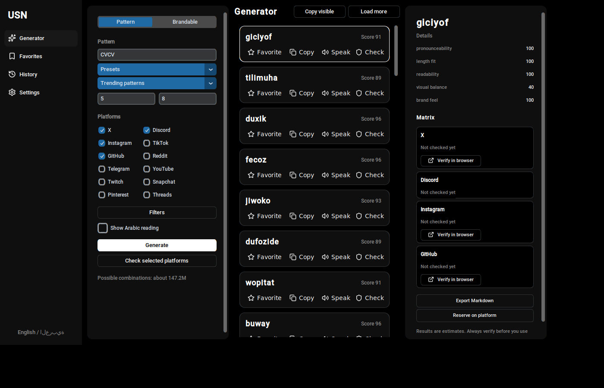
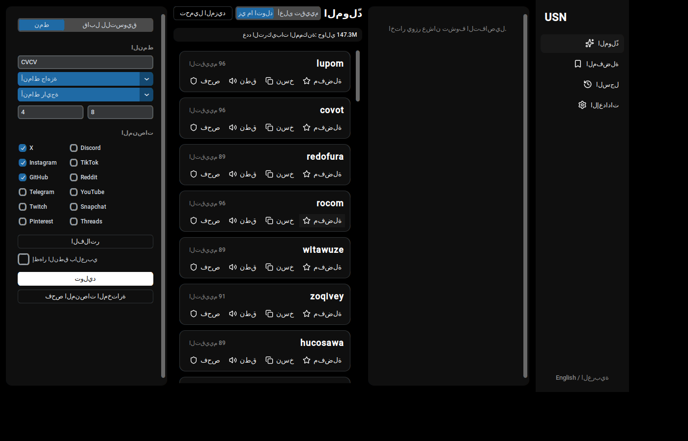

# USN: Username Generator & Availability Finder

USN is a desktop app that generates usernames from patterns, checks that they follow each platform's rules, looks at public profile pages to see whether a name is already taken, and keeps your favorites, used names, reminders and history. The interface is in Arabic and English, with Dark and Light themes.



> **Availability results are estimates.** USN reads public profile pages. A "Likely available" result can be wrong, and some platforms block automated checks. Always use **Verify in browser** before you register a name.

## Download

Get the latest build for Windows, macOS or Linux from the [Releases](../../releases) page. No Python install is needed.

## Run from source

Requires Python 3.11 or newer. On Linux, install Tk first (`sudo apt install python3-tk`).

```bash
pip install -r requirements.txt
python main.py
```

## Features

- **Generator.** Pattern mode with presets and trending patterns, or Brandable mode with syllable names or real English words. The length range is respected, and a pattern stretches to fill it.
- **Filters.** Start, end, contains, excluded characters (with or without spaces), a blocklist that also catches leetspeak, no repeated characters, no consecutive digits. An active-filter count and a reset button.
- **Clear explanations.** If an input can never match, USN says which platform forbids it. For example, a name starting with "." is rejected by Instagram, X and GitHub.
- **Platform rules.** 12 platforms, checked together, so a name is valid on every platform you select.
- **Availability.** Taken, Likely available, Unknown, Can't check here, or Invalid, with 24-hour caching, rate-limit backoff and a Verify in browser button. Large checks ask for confirmation first.
- **Name Score.** Five weighted factors with a hover tooltip, and sorting by best score.
- **Favorites.** Star, add notes, search, sort, and import or export JSON or CSV.
- **Used and reserved names.** Mark a name as used on a platform (the platform logo appears next to it), or reserve it and track it in the reminders manager (Reserved, Registered, Dropped).
- **Similarity warnings.** Warns before you save or mark a name that is almost the same as one you already have, or has the same letters.
- **History.** The last 100 batches, with restore.
- **Export.** Copy visible or favorite names, and save a platform matrix as Markdown or CSV.
- **Keyboard.** Editable shortcuts in Settings, and `?` for the cheat sheet.
- **Pronunciation preview.** Speaks a name aloud when a speech engine is available.
- **Languages and themes.** Arabic and English with right-to-left layout. Dark, Light, or follow the system.



## Platform rules: what has been checked

Rules live in `app/core/platform_rules.json`. Each entry has a `last_verified` value.

| Platform | Status |
|----------|--------|
| Discord | Checked on 2026-10-19 against the official Discord support page. |
| Telegram | Checked on 2026-10-19 against BotFather username guidelines as quoted in n8n's Telegram docs, and a validator source. |
| Instagram, TikTok, X, YouTube | Checked on 2026-10-19 against secondary sources only. Confirm on each platform's official help page before a large release. |
| GitHub, Reddit, Twitch, Snapchat, Pinterest, Threads | **Unverified.** Written from general knowledge. Check before you rely on them. |

Discord has no public profile page, so USN shows "Can't check here" for it and never guesses.

To correct a rule, edit the JSON and link to the official page in your pull request.

## Tests

```bash
python -m pytest -q
```

On Linux without a display, the GUI tests are skipped. To run them, use a virtual display: `xvfb-run -a python -m pytest -q`. CI runs the tests on Linux, Windows and macOS.

## Build a standalone app

```bash
pip install pyinstaller
pyinstaller --noconfirm usn.spec
```

The output is in `dist/USN`. The release workflow in `.github/workflows/release.yml` builds Windows, macOS and Linux versions when you push a tag such as `v1.0.0`, and attaches them to a GitHub Release.

## Where your data lives

| OS | Folder |
|----|--------|
| Windows | `%APPDATA%\USN` |
| macOS | `~/Library/Application Support/USN` |
| Linux | `~/.local/share/USN` (or `$XDG_DATA_HOME/USN`) |

Set `USN_DATA_DIR` to use a different folder. Files include `favorites.json`, `used.json`, `history.json`, `reminders.json`, `settings.json`, `cache.json` (24-hour availability cache) and `usn.log`.

## Project layout

```
main.py                 entry point
usn.spec                PyInstaller build
app/core/               pure logic, no UI or network: patterns, rules, filters, generator,
                        diagnosis, scoring, similarity, phonetics, brandable names, export
app/services/           availability checker, storage, repository, speech
app/ui/                 CustomTkinter screens and widgets
app/i18n/               en.json, ar.json and the translation lookup
assets/                 icons, blocklist, syllables, trending patterns, English word list
tools/build_icons.py    renders icons to PNG (see below)
tests/                  unit tests and GUI tests
.github/workflows/      CI (tests on 3 OS) and release (builds and uploads)
```

## Icons

The icons are pre-rendered PNGs in `assets/icons/`. UI icons come from Lucide (ISC licence). Platform logos come from Simple Icons (CC0). To rebuild them:

```bash
mkdir /tmp/iconsrc && cd /tmp/iconsrc && npm install lucide-static simple-icons
cd /path/to/usn && python tools/build_icons.py /tmp/iconsrc/node_modules
```

Platforms without a logo file show a monogram instead.

## Known limitations

- **Availability accuracy.** The checker reads public pages. Pages that need JavaScript, login walls and rate limits return "Unknown". USN never claims a name is available for certain.
- **Terms of use.** Check each platform's terms before automated checks at scale. USN limits itself to 4 requests per platform at a time and caches results for 24 hours.
- **Arabic letter shaping** depends on the operating system's Tk. It was tested on Windows. Some Linux builds may show disconnected Arabic letters.
- **No Arabic font is bundled.** The system font is used. Add a `.ttf` to `assets/fonts/` and register it in `app/ui/theme.py` if you need a specific one.
- **Speed in very long sessions.** A session can show up to 300 names. Export or copy them, then generate again to continue.
- **Pronunciation** needs a speech engine on the system. Some Linux systems have none.

## License

MIT. See [LICENSE](LICENSE). Word list: an-array-of-english-words (MIT), see `assets/DICTIONARY_LICENSE.txt`.
